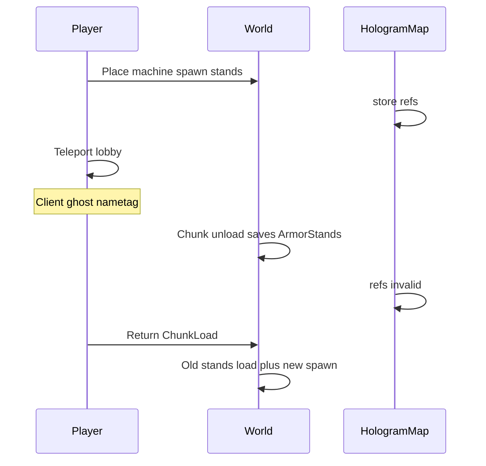

# Hologramas estáveis de máquinas e spawners

## Por que quebra hoje

Os dois managers ([`HologramManager.java`](tw-maquinas/src/main/java/br/com/tw/maquinas/managers/HologramManager.java) e [`SpawnerHologramManager.java`](tw-spawners/src/main/java/br/com/tw/spawners/managers/SpawnerHologramManager.java)) são o mesmo padrão:

- ArmorStand real no mundo, referências só num `ConcurrentHashMap<locKey, List<ArmorStand>>`
- `removeHologram` só chama `stand.remove()` se `isValid()`
- Não há `ChunkUnload`; `ChunkLoad` chama `updateOrCreateHologram`

Na 1.8.8 isso gera os sintomas:

1. **`/mina` ou `/lobby`** — o cliente troca de mundo sem sempre destruir nametag de ArmorStand invisível; o holograma “viaja” visualmente. No servidor os stands continuam no terreno e **salvam no chunk**.
2. **Unload** — as referências do Map ficam mortas. `removeHologram` não remove a entidade persistida.
3. **Volta / ChunkLoad / tick** — `anyMatch(Entity::isDead)` recria stands **em cima dos antigos** → duplicata.
4. **Desmontar** ([`MachinePanelMenu`](tw-maquinas/src/main/java/br/com/tw/maquinas/menus/MachinePanelMenu.java) slot 40, [`SpawnerPanelMenu`](tw-spawners/src/main/java/br/com/tw/spawners/menus/SpawnerPanelMenu.java) slot 49) só limpa o Map. Stands órfãos no chão ficam.

Abordagem escolhida: **continuar com ArmorStand nativo** (já funciona para vários jogadores no plot, sem ProtocolLib). Torná-los **efêmeros + etiquetados**, com purge no mundo e destroy packet só para quem sai do mundo.

## 1. Helper compartilhado no tw-core

Criar [`tw-core/.../hologram/TWHologram.java`](tw-core/src/main/java/br/com/tw/core/hologram/TWHologram.java) usado pelos dois plugins.

- Metadata `FixedMetadataValue(plugin, locKey)` com chave `"tw_hologram"` (não persiste em disco — por isso os stands **não podem** sobreviver ao unload).
- Spawn: `setVisible(false)`, `setGravity(false)`, `setCustomNameVisible(true)`, `setMarker(true)`, `setSmall(true)`, `setBasePlate(false)`.
- `purgeAt(Location loc, String locKey, Plugin plugin)`: `getNearbyEntities` num AABB curto (~2.5 blocos acima do bloco) e `remove()` em todo ArmorStand com metadata `tw_hologram` igual ao `locKey` **ou** (legado) invisível + nametag + sem gravity + sem item na mão, para limpar lixo já salvo no mundo.
- `removeMapped(Map, locKey)`: sempre `stand.remove()`, **sem** `if (isValid())`.
- `spawnLines(Location blockLoc, List<String> lines)`: offset atual (`1.0 + n * 0.28`, `+0.5` xz).
- `updateOrCreate(...)`: se Map ok e tamanho igual e nenhum morto → só `setCustomName`; senão `purgeAt` + spawn.
- `hideFromPlayer(Player, Collection<ArmorStand>)`: reflexão 1.8 (`PacketPlayOutEntityDestroy` + `CraftPlayer.getHandle().playerConnection.sendPacket`), no mesmo estilo de [`TWBossBar`](tw-minas/src/main/java/br/com/tw/minas/utils/TWBossBar.java) / [`ActionBarUtil`](tw-minas/src/main/java/br/com/tw/minas/utils/ActionBarUtil.java). Não remove a entidade no servidor (outros jogadores no plot continuam vendo).

Os dois managers passam a ser wrappers finos (texto das linhas) + Map local + listeners.

## 2. Ciclo de vida no mundo

Em **os dois** listeners ([`MachineListener`](tw-maquinas/src/main/java/br/com/tw/maquinas/listeners/MachineListener.java), [`SpawnerListener`](tw-spawners/src/main/java/br/com/tw/spawners/listeners/SpawnerListener.java)):

| Evento | Ação |
|--------|------|
| `ChunkLoad` | Já existe: recriar holograma se a máquina/spawner está naquele chunk. Antes, `purgeAt` (o helper já faz no recreate). |
| `ChunkUnload` | Novo: para cada holograma cujo bloco está no chunk, `purgeAt` + tirar do Map. Entidade não grava no region. |
| `PlayerTeleportEvent` (mundos diferentes) | Novo: enviar destroy packets dos stands do mundo de origem **só para esse jogador**. Cobre `/lobby`, `/mina`, warps. |
| Desmontar (menus) | Continuar `removeHologram`, agora com purge no bloco. |

Tick de 1s em [`MachineManager`](tw-maquinas/src/main/java/br/com/tw/maquinas/managers/MachineManager.java) / [`SpawnerManager`](tw-spawners/src/main/java/br/com/tw/spawners/managers/SpawnerManager.java) permanece só para atualizar texto; deixa de spawnar duplicata porque recreate sempre faz purge.

## 3. Varredura de órfãos

No `onEnable` de tw-maquinas e tw-spawners, task a cada 100 ticks (main thread):

- Mundos loaded → entidades ArmorStand com metadata `tw_hologram` cujo `locKey` **não** está em `placedMachines` / `placedSpawners` → `remove()`
- Se o locKey existe mas há mais stands do que linhas esperadas → `purgeAt` + um `updateOrCreate`

Isso limpa hologramas de máquinas já desmontadas e duplicatas antigas no chunk.

## 4. Fora de escopo

Inventários YAML, PlotSquared, PostgreSQL. Sem DecentHolograms / ProtocolLib.

## Arquivos

- Novo: `tw-core/src/main/java/br/com/tw/core/hologram/TWHologram.java`
- Editar: os dois `*HologramManager.java`
- Editar: `MachineListener`, `SpawnerListener` (`ChunkUnload` + teleport)
- Sem mudança de SQL; menus de desmontar já chamam `removeHologram`
